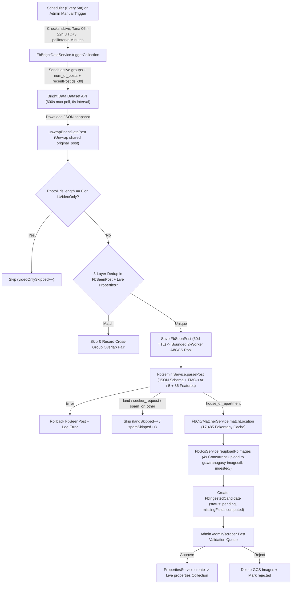

# TranoGasy Facebook Real-Estate Ingestion Pipeline — Architecture, Workflow & Strategy

> **Status:** Production-ready v1 (verified live on 19 Antananarivo public groups, Bright Data snapshot replay, Gemini multi-model failover, GCS image persistence, and Admin Fast Validation Dashboard).
> **Primary Value:** Replaces manual human scraping across ~20 high-volume Facebook groups with a cost-controlled, AI-filtered, human-verified ingestion funnel — isolating raw scraped posts from the live `properties` collection until approved in one click.

---

## 1. Strategic Design & Cost-Optimization Principles

Raw Facebook real-estate groups in Antananarivo generate **1,000–1,500+ posts/day** mixed with bare land sales (*tany amidy*), house-seeker requests (*mitady trano*), moving trucks/electronics spam, video-only reels, and heavy cross-posting by brokers across 5–10 groups simultaneously.

This pipeline minimizes Bright Data, Gemini AI, GCS storage, and human reviewer costs through five mechanisms:

1. **Master Pause Switch (`isLive: false` by default):**
   - Zero scheduled Bright Data runs or Gemini calls happen unless an admin toggles **LIVE (Actif)** in `/admin/scraper`.
2. **Tana Active-Hours Window (`onlyActiveHours: true`, `06:00–22:00` UTC+3):**
   - Skips 8 night hours when Malagasy posting volume is near zero, cutting scheduled Bright Data fetches by **~33%**.
3. **Bright Data Delta Exclusion (`posts_to_not_include`):**
   - Stores the last `40` `outerPostId` values per group (`recentPostIds`) and passes the newest `30` to Bright Data on each trigger so unchanged top posts are skipped upstream.
4. **Zero-Cost Pre-Filtering BEFORE Gemini or GCS:**
   - Every Bright Data record passes through deterministic TypeScript/MongoDB filters *before* spending any AI token or cloud storage bandwidth:
     - **Video-only / photo-less filter:** skips posts where `isVideoOnly || photoUrls.length === 0`.
     - **3-layer deduplication ledger (`fb_seen_posts`, 60-day TTL):** catches intra-group, cross-group, shared-post (`original_post`), exact normalized text hash, and fuzzy Malagasy phone + Jaccard text similarity duplicates.
     - **Live `properties` check:** avoids re-ingesting listings already published in Tranogasy.
   - *(Observed benchmark: on the first 19-group run `sd_mwf3ukhq3l44nfi83` with `89` Bright Data records, deduplication & video filtering eliminated more than half of the volume upfront — resulting in only `41` Gemini calls and `24–26` unique review candidates.)*
5. **Free-Tier Gemini Failover Pool & Zero-Cost Snapshot Replay:**
   - Uses `gemini-3.5-flash-lite` as default (`~1.4s` latency, higher Free Tier quota) with automatic failover across 5 verified Free Tier Flash models (`gemini-3.5-flash-lite`, `gemini-3.1-flash-lite`, `gemini-3.5-flash`, `gemini-3.6-flash`, `gemini-3-flash-preview`).
   - If all Gemini models fail on a post, its `FbSeenPost` ledger record is rolled back so an admin can replay the snapshot via **Importer Snapshot Bright Data (Gratuit)** (`POST /api/fb-ingestion/import-snapshot`) with **zero Bright Data cost**.
6. **Automatic GCS Garbage Collection:**
   - Rejecting a candidate or removing individual photos in the validation UI deletes the corresponding files under `fb-ingested/` in bucket `tranogasy-images` (`FbGcsService.deleteGcsUrls`) so storage never bloats with spam/rejected images.

---

## 2. End-to-End Ingestion Workflow

### Detailed Pipeline Stages

1. **Scheduling & Proportional Scaling (`tranogasy 2.0/backend/src/fb-ingestion/fb-ingestion.service.ts`):**
   - `@Cron('*/5 * * * *')` checks `FbIngestionConfig` (`isLive`, `onlyActiveHours` `activeHourStart..activeHourEnd` in UTC+3, and `pollIntervalMinutes`).
   - Requested `num_of_posts` scales dynamically relative to a 30-minute baseline:
     - `scaleFactor = Math.max(0.25, pollIntervalMinutes / 30)`
     - `num_of_posts = clamp(round(group.scrapeLimitPer30Min * scaleFactor), 2, 200)`

2. **Shared-Post Unwrapping (`fb-dedup.util.ts` -> `unwrapBrightDataPost`):**
   - Facebook users often re-share an existing listing into another group; Bright Data places the real listing inside `original_post`.
   - `unwrapBrightDataPost` prefers `original_post.post_id` as `canonicalPostId` while retaining the outer `post_id` as `outerPostId` (used for Bright Data `posts_to_not_include`) and merges attachments.

3. **Three-Layer Deduplication (`findSeenDuplicate` & `existsInLiveProperties`):**
   - **Layer A (ID Match):** Matches `canonicalPostId` or `rawPostIds` in `fb_seen_posts`.
   - **Layer B (Content Fingerprint):** Normalizes text (NFD accent strip, lowercase, punctuation removal via `normalizeTextForHash`) and matches SHA-256 `contentHash` (for posts `>= 25` normalized chars).
   - **Layer C (Broker Multi-Post Fuzzy Match):** Extracts normalized Malagasy numbers (`032/033/034/037/038/039 + 7 digits`, converting `+261` -> `0`) and computes token Jaccard similarity (`computeTextSimilarity`) against the last `15` `fb_seen_posts` sharing any phone number (`threshold >= 0.72`) and up to `10` live `properties` sharing any phone (`threshold >= 0.75`).
   - **Cross-Group Matrix Telemetry:** When a duplicate is seen in a different `groupId` than before, both groups increment `overlapByGroup.<otherGroupId>` so admins can identify redundant groups.

4. **Gemini Classification & Extraction (`fb-gemini.service.ts`):**
   - Enforces strict JSON output via `responseMimeType: 'application/json'` and `responseSchema`:
     - `category`: `'house_or_apartment' | 'land' | 'seeker_request' | 'spam_or_other'`
     - `type`: `'rent' | 'sale' | null`, `houseType`: `'maison' | 'appartement' | null`
     - **FMG → Ariary Conversion:** Explicit system rules enforce dividing FMG by 5 (`3.000.000 FMG` → `600.000 Ar`), setting `rentAriary` only for `rent` and `priceAriary` only for `sale`.
     - **Rooms & Area:** `rooms`, `livingRoom`, `kitchen`, `toilet`, `bathrooms`, `area`, `floor` — instructed to emit `null` rather than inventing `0` when omitted.
     - **Phones:** Merges regex-detected phones with Gemini-extracted phones.
     - **36 Boolean Features:** Maps Malagasy & French phrases (`moto miditra`, `tamboho`, `jiro sy rano jirama`, `rano paompy`, `vovo`, `fantsakana`, `misy fanaka`, `placard`, `gardien`, etc.) onto `PROPERTY_FEATURE_KEYS` matching Tranogasy's `Property` schema.
   - **Resilience:** Cycles `primaryModel` → `gemini-3.5-flash-lite` → `gemini-3.1-flash-lite` → `gemini-3.5-flash` → `gemini-3.6-flash` → `gemini-3-flash-preview`. Retries `503 UNAVAILABLE` once (`1500ms`) and fails over immediately on `429` quota limits.

5. **Malagasy Fokontany Geo-Matcher (`fb-city-matcher.service.ts`):**
   - Loads and caches all MongoDB `City` documents (~17,485 Fokontany) in memory for 30 minutes.
   - Scores normalized hints and post text:
     - Exact Fokontany match: `100` (`+4` priority for first hint)
     - Partial substring match: `78` (`+4`)
     - Word overlap: up to `65`
     - Direct raw-text Fokontany scan (`>= 5` chars): `72`
     - Commune match boost: `+12`
     - Antananarivo Renivohitra boost: `+14` (or `+10` for Analamanga / Antananarivo context)
   - Returns top `6` candidates with score `>= 45`, auto-selecting `bestMatch` when top score `>= 65`.

6. **GCS Image Re-Hosting (`fb-gcs.service.ts`):**
   - Facebook CDN image URLs expire quickly; up to `12` photos per post are downloaded (15s timeout, browser User-Agent, min 500 bytes, `image/*` check) and saved publicly to `fb-ingested/{safePostId}_{ts}_{idx}.{ext}` with 1-year `Cache-Control` using **4 concurrent workers** while preserving original photo ordering.
   - If CDN URLs in an old snapshot already expired, `aiNotes` notifies the reviewer to verify or add images before approval.

7. **Async Background Run & Real-Time UI Progress:**
   - Passing `async: true` on `POST /api/fb-ingestion/run` or `POST /api/fb-ingestion/import-snapshot` validates prerequisites synchronously, locks `isRunInProgress`, persists initial state in `fb_ingestion_configs`, and returns immediately (`{ started: true, status, phase }`).
   - Phases updated in MongoDB (`waiting_brightdata` every 6s, `downloading_snapshot`, `filtering_ai_gcs` with `{ current, total }`, `completed`, `error`) are polled every 3s by `/admin/scraper`, surviving browser refreshes seamlessly.

---

## 3. Codebase Map & Database Collections

### Backend (`tranogasy 2.0/backend/src/fb-ingestion/`)

| File | Responsibility |
| :--- | :--- |
| `fb-ingestion.module.ts` | Registers Mongoose schemas, imports `CitiesModule` / `PropertiesModule` / `Users`, exports `FbIngestionService`. |
| `fb-ingestion.controller.ts` | Exposes `POST /api/fb-ingestion/admin-login` (public) and admin-guarded endpoints under `@UseGuards(FbAdminGuard)`. |
| `fb-admin.guard.ts` | Validates `x-user-id` header against `User` collection (`role === 'admin' \|\| 'superadmin'`). |
| `fb-ingestion.service.ts` | Orchestrates bootstrapping (19 groups + pre-seeded admin), cron polling, Bright Data runs, 2-worker post processing, saturation telemetry, and approve/reject publishing. |
| `fb-brightdata.service.ts` | Bright Data Dataset v3 client (`listSnapshots`, `triggerCollection`, `waitForSnapshot`, `downloadSnapshot`). |
| `fb-gemini.service.ts` | Gemini REST JSON-schema extraction + Multi-model Free Tier fallback + `PROPERTY_FEATURE_KEYS`. |
| `fb-city-matcher.service.ts` | 17,485-Fokontany in-memory scorer & top-6 candidate resolver. |
| `fb-gcs.service.ts` | 4x concurrent FB CDN -> GCS re-uploader (`fb-ingested/`) & safe deleter. |
| `fb-dedup.util.ts` | Shared-post unwrapper (`unwrapBrightDataPost`), SHA-256 text normalizer, Malagasy phone extractor, Jaccard similarity. |
| `fb-seed.data.ts` | Initial 19 Antananarivo public groups from `facebook (3).csv`. |
| `schemas/fb-ingestion-config.schema.ts` | Singleton `default` config, live toggle, schedule settings, error state, phase/progress, and `lastRunSummary`. |
| `schemas/fb-group-target.schema.ts` | Group URL, activity limits, `recentPostIds`, measured velocity (`measuredPostsPerDay`, `measuredPostsPer30Min`, `peakPostsPer30Min`), saturation alerts, and `overlapByGroup`. |
| `schemas/fb-seen-post.schema.ts` | 60-day TTL dedup ledger indexing `canonicalPostId`, `rawPostIds`, `contentHash`, `phones`, and `seenInGroupIds`. |
| `schemas/fb-ingested-candidate.schema.ts` | Staging review queue isolated from `properties`; stores raw FB post, GCS photos, `extracted` struct, `missingFields`, `cityCandidates`, `status`, and `publishedPropertyId`. |

### Frontend (`tranogasy 2.0/frontend/src/`)

| File | Responsibility |
| :--- | :--- |
| `services/fbIngestion.service.ts` | Layer-1 API client via `apiFetch` with `x-user-id` admin header. |
| `app/admin/scraper/page.tsx` | Master control console: Admin phone/email login gate, LIVE/PAUSE toggle, poll interval, Gemini model selector, snapshot importer, live progress bar + timer, dismissible error banner, tabs. |
| `components/admin/scraper/ValidationQueueTab.tsx` | Side-by-side raw FB text + editable structured form, FMG preview, GCS gallery manager, Fokontany search, 36 feature toggles (`featureLabels.ts`), Save / Approve / Reject actions. |
| `components/admin/scraper/GroupsManagerTab.tsx` | Group CRUD, estimated daily Bright Data record calculator, single-group test scrape, `Saturé` warning badges with quick `+3 posts limite` button. |
| `components/admin/scraper/OverlapMatrixTab.tsx` | Redundancy rate leaderboard showing top overlapping group pairs so high-duplication groups can be paused. |
| `app/account/page.tsx` | Displays Admin shortcut button linking to `/admin/scraper` when `role === 'admin' \|\| 'superadmin'`. |

---

## 4. Environment Variables Reference (`tranogasy 2.0/backend/.env`)

Never commit real secrets. Configure these keys in `.env` / cloud secret manager:

| Variable | Purpose |
| :--- | :--- |
| `BRIGHT_DATA_API_KEY` | Bearer token for Bright Data Dataset API v3 |
| `BRIGHT_DATA_DATASET_ID` | Facebook Groups dataset ID (default: `gd_lz11l67o2cb3r0lkj3`) |
| `GEMINI_API_KEY` | Google AI Studio API key |
| `GEMINI_MODEL` | Preferred model override (default: `gemini-3.5-flash-lite`) |
| `GCS_BUCKET_NAME` | Target Google Cloud Storage bucket (`tranogasy-images`) |
| `GCS_PROJECT_ID` | GCP project ID |
| `GCS_SERVICE_ACCOUNT_JSON` | Service account JSON string for GCS uploads/deletes |
| `ADMIN_PRESEED_PHONE` | Pre-seeded admin phone (`0340000001` default) |
| `ADMIN_PRESEED_EMAIL` | Pre-seeded admin email (`admin@tranogasy.mg` default) |
| `ADMIN_PRESEED_PASSWORD` | Initial bcrypt-hashed password when bootstrapping admin account |
| `ADMIN_PRESEED_USERNAME` | Initial admin display name |

---

## 5. Known Constraints & Future Improvement Roadmap

1. **Perceptual Image Hashing (pHash):**
   - Brokers sometimes repost identical photos across groups with rewritten descriptions and alternate SIM cards; adding an image perceptual hash check to `fb_seen_posts` will catch zero-text-overlap reposts before Gemini/GCS.
2. **Price Unit Sanity Checks:**
   - Add an automated warning badge (`suspectFmgNotConverted`) when `type === 'rent' && rent > 20_000_000` (almost certainly unconverted FMG) or `type === 'sale' && price < 5_000_000`.
3. **Adaptive Auto-Tuning & Auto-Pruning:**
   - Automatically adjust `scrapeLimitPer30Min` up when `missedWindowAlerts >= 2` consecutively, and surface one-click *"Pause >75% Redundant Groups"* actions in the Overlap Matrix.
4. **Separate Queues for Land (`land`) & Seeker Leads (`seeker_request`):**
   - Currently `land` and `seeker_request` are skipped to keep Tranogasy's housing feed clean. Once TranoGasy launches land plots (*Tany amidy*) or B2B buyer lead matching, route those categories into dedicated tabs rather than discarding them.
5. **Multimodal Gemini Vision Fallback:**
   - When post text omits room counts (`missingFields` contains `rooms` or `bathrooms`) or contains phone numbers watermarked inside photos, optionally send 1–3 uploaded photos alongside text to Gemini Vision for richer extraction.
6. **Distributed Poll Lock & JWT/Firebase Guard:**
   - `this.isRunInProgress` is currently in-memory (designed for a single backend instance). Before running multiple horizontally scaled backend containers, replace it with an atomic MongoDB lock document (`lockExpiresAt`) and upgrade `FbAdminGuard` from `x-user-id` lookup to signed JWT / Firebase token verification.
7. **Gilbert IA Conversational Property Discovery:**
   - Reuse the 36 `PROPERTY_FEATURE_KEYS`, `FbCityMatcherService` Fokontany matcher, and Gemini structured JSON Schema approach to translate natural-language Malagasy/French buyer chats directly into MongoDB property queries.
