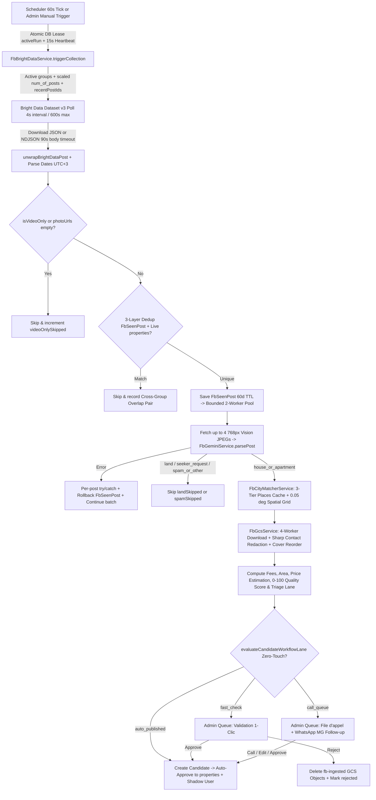

# TranoGasy Facebook Real-Estate Ingestion Pipeline — Architecture, Workflow & Reference

> **Status:** Production Architecture (Verified across distributed multi-instance lease locking, Bright Data v3 scraping & free snapshot replay, Multimodal Gemini Vision OCR + deterministic feature/pricing analysis, 3-tier Google Places + Fokontany spatial grid matching, Sharp pixel contact redaction, GCS storage, Zero-Touch auto-approval, Shadow User ownership claims, and the `/admin/scraper` control console).
> **Primary Value:** Replaces manual monitoring across Malagasy public Facebook real-estate groups with a fault-isolated, cost-controlled, multi-instance-safe ingestion pipeline — triaging listings into Zero-Touch auto-publication, 1-click validation, or an advertiser follow-up call queue while keeping raw posts isolated from `properties` until approved.

---

## 1. Strategic Design & Cost-Optimization Principles

Antananarivo and regional Facebook real-estate groups mix residential/commercial rentals and sales with bare land plots (*tany amidy*), house-seeker posts (*mitady trano*), unrelated commerce spam, video-only reels, watermarked agency numbers inside images, and heavy cross-posting across groups.

The pipeline minimizes Bright Data, Gemini AI, Google Places API, GCS storage, and human moderation costs through seven layers:

1. **Master Pause Switch (`isLive: false` by default):**
   - Zero scheduled Bright Data or Gemini calls occur unless an admin switches the console to **LIVE (Actif)** in `/admin/scraper`.
2. **Tana Active-Hours Window (`onlyActiveHours: true`, `06:00–22:00` UTC+3):**
   - `getMadagascarHour()` restricts scheduled polling to Madagascar daytime (`activeHourStart..activeHourEnd`), skipping 8 night hours to cut scheduled Bright Data fetches by **~33%**.
3. **Bright Data Delta Exclusion (`posts_to_not_include`):**
   - Each `FbGroupTarget` retains its latest `40` `outerPostId` values (`recentPostIds`). When triggering Bright Data, `executeRunActiveGroups` passes the newest `30` (clamped to `50` in `FbBrightDataService.triggerCollection`) in `posts_to_not_include` to avoid re-fetching unchanged top posts upstream.
4. **Zero-Cost Pre-Filtering Before Gemini, Places, or GCS:**
   - Every Bright Data record passes deterministic TypeScript/MongoDB filters *before* spending AI tokens or storage bandwidth:
     - **Video-only / photo-less filter:** skips posts where `isVideoOnly || photoUrls.length === 0`.
     - **3-layer deduplication ledger (`FbSeenPost`, 60-day TTL):** catches intra-group, cross-group, shared-post (`original_post`), exact SHA-256 normalized text hashes (`>= 25` chars), and Malagasy phone + Jaccard text similarity duplicates (`>= 0.72`).
     - **Live `properties` check (`existsInLiveProperties`):** avoids re-ingesting listings already present by `sources.postId`, `sources.link`, or shared phones (`>= 0.75` description similarity).
5. **Multimodal Gemini Vision + 5-Model Free-Tier Failover Pool & Deterministic Merging:**
   - Downscales up to `4` photos per eligible post to compact `768px` JPEGs (`quality: 78`) alongside text for single-pass Vision OCR (extracting watermarked phone numbers, prices, visual condition, habitable area estimates, cover choice, and contact bounding boxes).
   - Cycles from the configured `primaryModel` through `gemini-3.5-flash-lite`, `gemini-3.1-flash-lite`, `gemini-3.5-flash`, `gemini-3.6-flash`, and `gemini-3-flash-preview` (retrying `503` once after `1500ms`, failing over immediately on `429`/`503`).
   - Deterministic `fb-feature-analyzer.util.ts` post-processes description layout, agency fees, room defaults, 37 feature booleans, market prices, and quality score at zero AI cost (also runnable in bulk via **Réanalyser la file**).
6. **3-Tier Cached Google Places + Spatial Grid Fokontany Resolution:**
   - Wraps Google Places calls in an in-memory LRU (`4,000` entries), singleflight in-memory request coalescing, and persistent MongoDB `FbPlaceGeoCache` (`90`-day TTL for hits, `7`-day for `not_found`), mapping coordinates to the nearest MongoDB `City` Fokontany via a `0.05°` (~5.5 km) 2D grid index before falling back to local text scoring.
7. **Zero-Cost Snapshot Replay & Automatic GCS Garbage Collection:**
   - If Gemini or post prep fails on an individual post, its `FbSeenPost` entry is rolled back inside `try/catch` without aborting the rest of the snapshot. Admins can replay any snapshot at zero Bright Data cost via **Importer Snapshot Bright Data (Gratuit)** (`POST /api/fb-ingestion/import-snapshot`).
   - Rejecting a candidate or removing gallery photos automatically deletes objects strictly under the `fb-ingested/` prefix (`FbGcsService.deleteGcsUrls`), while reusable publisher profile photos live separately under `fb-avatars/`.

---

## 2. End-to-End Ingestion Workflow

### Detailed Pipeline Stages

#### Stage 1: Scheduling, Proportional Scaling & Distributed Lease Locking
- **Tick Loop (`fb-ingestion.service.ts`):** `onModuleInit()` initializes a `15_000`ms (`15s`) `setInterval` (`schedulerTimer`) plus a precision `setTimeout` (`precisionTriggerTimer`) when a cycle boundary is within `65s`, after bootstrapping default config, target groups, and running orphaned-job recovery. `schedulerTick()` persists heartbeats (`lastSchedulerTickAt`, `lastSchedulerStatus`, `lastSchedulerNote`), appends state transitions/runs to `activityLog` (capped to 30) and `runHistory` (capped to 12), and `getConfigWithDiagnostics()` computes live `schedulerDiagnostics` (`paused`, `waiting_next_cycle`, `due_now`, `running`, `importing_snapshot`, `sleeping_night`, `no_active_groups`).
- **Multi-Instance Safe Distributed Leases (`activeRun` & `activeBackfill`):**
  - Because local dev and production (e.g. Render) can point to the same MongoDB Atlas database, runs and backfills never rely solely on in-memory flags.
  - Each process identifies itself via `instanceId = "${os.hostname()}:${process.pid}:${crypto.randomUUID()}"`.
  - `markRunStarted()` atomically acquires `activeRun` via `configModel.findOneAndUpdate`, emits a heartbeat every `15_000`ms (`RUN_HEARTBEAT_INTERVAL_MS`), and expires leases only if `heartbeatAt` / `updated_at` exceeds `120_000`ms (`RUN_STALE_LEASE_MS`) or if `ownerHost` matches the local machine and `process.kill(ownerPid, 0)` throws `ESRCH`.
  - Crucially, root `lastPollStatus` stays non-`'running'` in MongoDB while `activeRun` is active; `applyActiveStateOverlay()` projects `activeRun` (and `activeBackfill`) onto API responses as `lastPollStatus: 'running' | 'importing_snapshot'`, preventing older server instances without `activeRun` support from mistakenly marking active runs as interrupted.
  - `onModuleDestroy()` aborts in-flight Bright Data/HTTP fetches and clears the local instance's active lease on shutdown.
- **Proportional Fetch Scaling:**
  - `scaleFactor = Math.max(0.25, config.pollIntervalMinutes / 30)`
  - `num_of_posts = clamp(round((group.scrapeLimitPer30Min || 10) * scaleFactor), 2, 200)`

#### Stage 2: Bright Data Collection, Batching & Pending Snapshot Recovery (`fb-brightdata.service.ts`)
- **Chunked Triggering (`MAX_GROUPS_PER_SNAPSHOT = 7`):** When `> 7` active groups are enabled, `executeRunActiveGroups` automatically splits them into sequential batches of up to `7` groups (`[Lot X/Y]`) so one slow Facebook group never stalls or invalidates all other groups.
- `triggerCollection` posts target URLs + `num_of_posts` + `posts_to_not_include` (`<= 50` IDs) with a `30s` abortable timeout.
- `waitForSnapshot` (`getSnapshotProgress`) polls `/progress/{snapshotId}` every `4s` up to `900s` (`15 min` for single batch) or `600s` (`10 min` per batch when chunked), tolerating up to `3` consecutive transient network errors while driving an asymptotic progress curve (`10% -> 55%`).
- **Zero-Credit Timeout Recovery (`pendingSnapshots`):** If Bright Data times out (`BrightDataSnapshotTimeoutError`) or a server restart interrupts `waiting_brightdata`, the `snapshotId` is saved in `pendingSnapshots` (`35m` TTL). While pending, `schedulerTick()` polls `/progress/{snapshotId}` every `45s` without launching duplicate paid triggers and auto-imports the snapshot at zero extra Bright Data cost as soon as it transitions to `ready` (admins can also check/import or dismiss manually via `POST /api/fb-ingestion/pending-snapshots/recover` and `DELETE /api/fb-ingestion/pending-snapshots/:snapshotId`).
- `downloadSnapshot` enforces a `90s` (`90_000`ms) abort signal covering both HTTP headers and reading the full `res.text()` body, parsing both JSON arrays and NDJSON streams.
- Active runs can be cancelled mid-flight via `POST /api/fb-ingestion/run/cancel`, which triggers `AbortController.abort()` and stops group/worker loops cleanly.

#### Stage 3: Unwrapping, Date Normalization, 3-Layer Dedup & Telemetry (`fb-dedup.util.ts`)
- **Shared-Post Unwrapping (`unwrapBrightDataPost`):**
  - When a post re-shares another listing (`original_post`), `canonicalPostId` uses `original_post.post_id` while retaining the wrapper `post_id` as `outerPostId` for `posts_to_not_include` tracking. Attachments and author metadata (`authorName`, `authorFbId`, `authorUrl`, `authorAvatar`) are normalized while rejecting Facebook group `header_image` and default silhouette URLs.
  - `parseBrightDataDate` converts Unix timestamps, ISO dates, `"Just now"` / `"À l'instant"`, relative minutes/hours/days, `"Yesterday"` / `"Hier"`, and French/English month strings in `UTC+3` (Madagascar time).
- **Sequential Pre-Filter & 3-Layer Deduplication:**
  - Posts with `isVideoOnly || photoUrls.length === 0` increment `videoOnlySkipped` before dedup.
  - Remaining posts are checked sequentially per group against `FbSeenPost` (`60`-day TTL index on `expiresAt`):
    - **Layer A (ID Match):** Matches `canonicalPostId` or `rawPostIds`.
    - **Layer B (Content Fingerprint):** Normalizes text (`normalizeTextForHash`) and matches SHA-256 `contentHash` (`normalizedText.length >= 25`).
    - **Layer C (Phone + Fuzzy Jaccard):** Extracts Malagasy mobile numbers (`032/033/034/037/038/039 + 7 digits`) and compares `computeTextSimilarity` against the newest `15` `FbSeenPost` entries sharing any phone (`threshold >= 0.72` when `normalizedText.length >= 20`).
  - `existsInLiveProperties` checks the live `properties` collection by `sources.postId`, `sources.link` regex, or shared phone numbers (`limit 10`, Jaccard similarity `>= 0.75`).
  - Cross-group duplicates credit bidirectional counts in `overlapByGroup`.
- **Group Velocity & Saturation Tracking:**
  - Blends post-timestamp spans into `measuredPostsPer30Min` (40% historical / 60% current EWMA), derives `measuredPostsPerDay` (`* 32` for a 16h active window), tracks `peakPostsPer30Min`, and increments `missedWindowAlerts` (flagging `lastRunCapturedAll = false`) whenever fetched count saturates `scrapeLimitPer30Min` with 100% new posts.

#### Stage 4: Bounded 2-Worker AI Vision + Deterministic Feature, Area & Pricing Engine
- Eligible posts are processed concurrently in a **bounded 2-worker pool** (`processSingleEligiblePost`):
  - **Vision Preparation:** `FbGcsService.fetchVisionInlineImages` fetches up to `4` photos (`768px` max dimension, JPEG quality `78`, 10s timeout) and encodes them as inline base64 parts.
  - **Multimodal Extraction (`fb-gemini.service.ts`):** Uses `responseMimeType: 'application/json'` and strict `responseSchema`:
    - `category`: `'house_or_apartment' | 'land' | 'seeker_request' | 'spam_or_other'`
    - `type`: `'rent' | 'sale' | null`
    - `houseType`: `'maison' | 'villa' | 'appartement' | 'bureau' | 'tsena'` (normalized via `common/property-types.util.ts`)
    - **FMG -> Ariary Rule:** Explicitly enforces `FMG / 5 = Ariary` on both post text and OCR-read image text (`rentAriary` for `rent`, `priceAriary` for `sale`).
    - **Visual & Privacy Outputs:** `visualAreaEstimateSqm`, `visualCondition` (`new_or_modern`, `good`, `average`, `basic_or_worn`), `recommendedCoverPhotoIndex`, and `imageContacts` (0..1000 bounding boxes + `isFullContactCard`).
  - **Deterministic Post-Processing (`fb-feature-analyzer.util.ts`):**
    - `preserveDescriptionLayout`: Keeps original post line breaks and paragraph spacing if Gemini collapses lines.
    - `mergeGeminiAndDeterministicFeatures`: Scans FR/MG/EN phrases and negations across all **37 boolean keys** (`PROPERTY_FEATURE_KEYS`, including `waterFetchExternal` / *maka rano*) and produces a 5-axis `featureVerification` map (`carAccess`, `motoAccess`, `waterSupply`, `electricitySupply`, `furnishedProperty` -> `'yes' | 'no' | 'unknown'`).
    - `extractAgencyFees`: Parses `visitFee`, `cautionPercent`, `cautionAmount`, `commissionPercent`, and `commissionAmount`.
    - `resolveResidentialRoomDefaults` & `estimatePropertyArea`: Fills residential kitchen/living/sanitary defaults and computes fallback m² estimates.
    - `estimatePropertyPriceAriary`: Blends a calibrated Antananarivo/Madagascar zone-tier matrix, standing multipliers, Gemini estimates, and comparable DB medians into `estimatedPrice` / `estimatedRent`, `estimatedPriceMin`, `estimatedPriceMax`, and `estimatedPriceConfidence`.
    - `computePropertyQualityScore`: Scores every listing from `1–100` across photo richness & visual condition (`0–35`), data completeness & comfort (`0–35`), AI/phone reliability (`0–20`), and publication freshness (`0–10`).
  - **Per-Post Fault Isolation:** Both the Gemini call block and downstream geo/GCS/scoring prep wrap errors in `try/catch`, rolling back `FbSeenPost` and appending to `summary.errors` so one malformed post or transient API error never halts remaining posts.

#### Stage 5: 3-Tier Google Places + Spatial Grid Fokontany Geo-Matching
- **`FbCityMatcherService` (`fb-city-matcher.service.ts`):**
  - Loads all MongoDB `City` documents (~17,485 Fokontany) into memory for 30 minutes and indexes valid coordinates into `0.05°` (~5.5 km) `spatialGrid` cells.
  - `buildPlaceQueryPlan` combines Gemini `locationHints` with deterministic corridor/landmark regex extractors (`by pass`, `67ha`, `marais masay`, `route d'...`, `rond-point ...`, `akaiky ...`) into up to `2` specific queries scoped to an inferred regional bias circle (`Antananarivo` default + 8 regional Malagasy hubs).
- **`FbPlacesService` (`fb-places.service.ts`):**
  - Resolves queries through **Tier 1:** LRU memory cache (`4,000` entries), **Tier 3:** singleflight `inFlight` deduplication map, and **Tier 2:** MongoDB `FbPlaceGeoCache` (`90d` TTL for matches, `7d` for misses).
  - Queries Google Places API (New) `places:searchText` with a minimal SKU field mask (`places.id,places.displayName,places.formattedAddress,places.location`), automatically falling back to Legacy Find Place, Place Autocomplete (`components=country:mg`), and Google Geocoding API.
  - Enforces Madagascar bounds (`lat -26.2..-11.4`, `lng 42.5..51.2`), maps coordinates to up to `6` nearest DB Fokontany via Haversine + name tie-breaking (`bestMatch` when `<= 15,000m`), or falls back to deterministic text scoring (`matchByTextFallback`, score `>= 45`, auto-select `>= 65`).
  - Pending candidates missing `matchedCityId` also auto-resolve lazily when `GET /api/fb-ingestion/candidates` is called (unless `manualCityOverride: true`), and admins can interactively resolve queries via `GET /api/fb-ingestion/resolve-location`.

#### Stage 6: Server-Side Pixel Contact Redaction & GCS Persistence (`fb-gcs.service.ts`)
- **`reuploadFbImages`:** Downloads up to `12` images via **4 concurrent workers** (15s timeout, `image/*`, `>= 500` bytes).
- **Contact Privacy Blur (`redactImageBuffer`):** Uses `sharp` to extract normalized `0..1000` bounding boxes (`imageContacts`) with a 2% margin, blurs (`blur(26)`) + darkens (`brightness: 0.42`) regions and composites them back irreversibly — or blurs/darkens the entire frame (`blur(32)`, `brightness: 0.55`) if `isFullContactCard` is set.
- **Smart Cover Ordering:** Moves `recommendedCoverIndex` to position `0` and pushes `isFullContactCard` images to the end of `gcsImages` under `fb-ingested/{safePostId}_{ts}_{idx}[_redacted].{ext}` (`Cache-Control: public, max-age=31536000`).
- **Publisher Avatar Storage (`reuploadFbAvatar`):** Saves avatars separately under `fb-avatars/{safeKey}.{ext}` (reusing cached GCS avatars by `authorFbId`) so rejecting one candidate never deletes a shared publisher avatar.

#### Stage 7: 3-Tier Triage ("Zero-Touch"), Publishing & Admin Review
Each processed candidate is assigned a `workflowLane` by `evaluateCandidateWorkflowLane`:
- **`auto_published` (Zero-Touch IA):** When `autoApproveEnabled` is `true` and the candidate has `type`, `matchedCityId`, phone, `>= 1` GCS image, explicit price or allowed estimated price (`autoApproveAllowEstimatedPrice`), `qualityScore >= autoApproveMinQualityScore` (default `75`), and sufficient `aiConfidence` (`high`, or `medium` with `qualityScore >= max(82, minScore + 5)`), it is immediately published via `approveCandidate(..., 'system_auto', { isAutoApproved: true })`.
- **`fast_check` (`🟡 Validation 1-Clic`):** Complete listing ready for rapid human confirmation/editing in `/admin/scraper`.
- **`call_queue` (`🟠 File d'appel`):** Missing one or more core prerequisites (type, Fokontany, phone, image, or price). Admins can trigger phone calls (`tel:`), send targeted Malagasy WhatsApp follow-ups (`💬 WhatsApp (MG)`), and track `contactFollowUpStatus` (`none`, `called`, `messaged_waiting`, `answered`).

---

## 3. Shadow Users, Contact Locking & Ownership Claims

Scraped properties published to `properties` look native on the public site while maintaining strict admin auditability and monetization protections:

- **Dedicated Shadow Publishers (`upsertShadowFbPublisher`):**
  - Instead of assigning scraped listings to an admin account, `approveCandidate` creates or reuses a shadow `User` (`isShadowAccount: true`, `origin: 'facebook_scraper'`, `fbUserId`, `fbProfileUrl`, `mergedIntoUserId: null`).
  - Matches strictly on `fbUserId` or normalized `fbProfileUrl` (never display name alone) and intentionally omits `phone` so real OTP registrations never collide.
- **Listing Origin, Contact Locking & Public Sanitization (`properties.service.ts`, `property-sanitizer.util.ts`):**
  - Published listings store `origin: 'facebook_scraper'`, `claimStatus: 'unclaimed'`, `contactAccessLocked: true`, `contactUnlockCostJp: 50`, and `sources` (`fbUserId`, `username`, `avatar`, `link`, `postId`, `postUrl`, `groupId`).
  - For non-admin callers, `sanitizePropertyForViewer` and `sanitizeOwnerForViewer` strip `origin`, `claimStatus`, `claimedBy`, `claimedAt`, `estimatedArea`, `qualityScore`, `visualCondition`, `isShadowAccount`, `fbUserId`, `fbProfileUrl`, and `mergedIntoUserId`.
  - Unless unlocked (`POST /api/properties/:id/unlock-contact`), public viewers receive `contactLocked: true`, `maskedPhonePreview` (`034 •• ••• ••`), null phone fields, and `[Contact protégé]` / `[Lien protégé]` scrubbed descriptions.
- **Real User Claim Flow (`properties.controller.ts`):**
  - Logged-in users with a verified phone query `GET /api/properties/claimable` to find matching `unclaimed` `facebook_scraper` listings (`phone1`/`phone2`/`phone3`) and claim them via `POST /api/properties/claim` (`adoptUsername`, `adoptAvatar`), flipping `claimStatus` to `'claimed'`, reassigning `owner`, and setting `mergedIntoUserId` on retired empty shadow profiles.
- **Idempotent Legacy Backfill Job (`executeBackfillJob`):**
  - Admins can run **Migrer les anciennes annonces FB (Shadow Users)** (`POST /api/fb-ingestion/properties/backfill-shadow-owners`) to normalize phone formats, re-host temporary FB avatars to GCS, backfill `origin` (`facebook_scraper` vs `admin_manual` vs `user`) and `claimStatus`, and move legacy admin-owned scraped listings onto Shadow Users — tracked asynchronously via `activeBackfill` + `backfillJob`.

---

## 4. Admin Console (`/admin/scraper`)

Guarded by an inline Admin Login gate (`POST /api/fb-ingestion/admin-login` supporting phone or email + password) and `FbAdminGuard`, the page polls adaptively (`2s` while running, `3s` within `25s` of a cycle boundary, `10s` while LIVE idle, `30s` while paused, plus `visibilitychange` refresh), polls active backfill jobs every `1.5s`, keeps visited tabs mounted for instant switching, and renders `ScraperCycleCockpit` + a persistent bottom-right `FloatingOperationHud`:

| Tab | Key Capabilities |
| :--- | :--- |
| **File de validation rapide** (`ValidationQueueTab.tsx`) | Status tabs (`En attente`, `Approuvés`, `Rejetés`, `Tous`), triage pills (`🟡 Validation 1-Clic`, `🟠 File d'appel`, `⏳ En attente réponse`), `📞 Grouper par annonceur` mode, `⚡ Auto-publier les éligibles`, 0-credit bulk/single deterministic reanalysis, side-by-side raw text vs editable form, live Fokontany + Google Places lookup, 37 feature toggles (`featureLabels.ts`), zoomable `AdminPhotoGalleryModal` (reorder cover / delete GCS photos / add photos), Call & Malagasy WhatsApp buttons, Approve / Save / Unpublish / Reject. |
| **Groupes cibles & Fréquence** (`GroupsManagerTab.tsx`) | Group CRUD (`isActive` optimistic `AsyncToggleSwitch`, inline `scrapeLimitPer30Min` editor), live daily Bright Data credit estimator, single-group test run trigger, saturation warnings (`Saturé` / `missedWindowAlerts`), and measured velocity telemetry. |
| **Matrice de similarité** (`OverlapMatrixTab.tsx`) | Redundancy leaderboard sorting groups by duplicate overlap percentage with shared-post pair badges and instant pause switches. |
| **Origines & Réclamations** (`PublishedOriginsTab.tsx`) | Live `properties` audit list filtered by `origin` (`facebook_scraper`, `user`, `admin_manual`), `claimStatus` (`unclaimed`, `claimed`), and search; Shadow User & GCS Avatar backfill launcher with live `OperationProgressCard` + cancel/retry. |

Top control bar features **LIVE/PAUSE** toggle, poll interval selector (`10m`, `15m`, `30m`, `60m`), Gemini model selector, **Tana active-hours** toggle, **Zero-Touch Auto-Validation** settings (`autoApproveEnabled`, min quality score `65`/`75`/`85`, `Inclure Prix Estimé IA`), **Free Snapshot Importer** (`sd_...` datalist), and `ScraperCycleCockpit` (SVG circular countdown ring synced to server UTC+3 clock, cycle progress bar, 4-stage continuous loop visualizer, backend heartbeat badge, KPI pills, and expandable chronological **Faits & gestes** activity log + run history).

---

## 5. Codebase Map & MongoDB Collections

### Backend (`tranogasy 2.0/backend/src/`)

| File | Responsibility |
| :--- | :--- |
| `fb-ingestion/fb-ingestion.module.ts` | Registers `FbIngestionConfig`, `FbGroupTarget`, `FbSeenPost`, `FbIngestedCandidate`, `FbPlaceGeoCache`, `Property`, `City`, and `User` schemas and module providers. |
| `fb-ingestion/fb-ingestion.controller.ts` | Exposes public `POST /api/fb-ingestion/admin-login` and `@UseGuards(FbAdminGuard)` admin routes. |
| `fb-ingestion/fb-admin.guard.ts` | Validates `x-user-id` ObjectId against `User` (`role === 'admin' \|\| 'superadmin'`). |
| `fb-ingestion/fb-ingestion.service.ts` | Bootstrapping, `15s` scheduler loop + precision timer, `schedulerDiagnostics`, `activityLog`/`runHistory`, `15s` lease heartbeats (`activeRun`/`activeBackfill`), `120s` stale recovery, 2-worker AI/GCS orchestrator, triage, approve/unpublish/reject, Shadow Users, and legacy backfill. |
| `fb-ingestion/fb-brightdata.service.ts` | Bright Data Dataset v3 client (`listSnapshots`, `triggerCollection`, `waitForSnapshot` 4s poll, `downloadSnapshot` 90s full-body timeout). |
| `fb-ingestion/fb-gemini.service.ts` | Multimodal Gemini REST JSON-Schema parser + 5-model Free-Tier failover pool. |
| `fb-ingestion/fb-feature-analyzer.util.ts` | Deterministic FR/MG/EN parser: layout preservation, 37 features, 5-axis verification, agency fees, room defaults, habitable area, hybrid market pricing, and 0–100 quality scoring. |
| `fb-ingestion/fb-places.service.ts` | 3-tier cached Google Maps Places (`places_v1`, `places_legacy`, Autocomplete/Geocode) client with singleflight coalescing & Madagascar bounds. |
| `fb-ingestion/fb-city-matcher.service.ts` | In-memory 17,485-Fokontany cache + `0.05°` 2D spatial grid Haversine matcher + text fallback scorer. |
| `fb-ingestion/fb-gcs.service.ts` | 4x concurrent FB->GCS uploader (`fb-ingested/`), `768px` Vision resizer, `sharp` pixel contact box redaction, cover promotion, `fb-avatars/` cache, and prefix-restricted deletion. |
| `fb-ingestion/fb-dedup.util.ts` | Shared-post unwrapper (`unwrapBrightDataPost`), `normalizeFbProfileUrl`, `extractFbUserId`, UTC+3 `parseBrightDataDate`, SHA-256 normalizer, phone extractor, and Jaccard similarity. |
| `fb-ingestion/fb-seed.data.ts` | Seed list of 19 public Antananarivo Facebook real-estate groups (`INITIAL_FB_GROUP_TARGETS`). |
| `fb-ingestion/schemas/fb-ingestion-config.schema.ts` | Singleton `default` config, live/scheduler/Zero-Touch settings, `activeRun`/`activeBackfill` leases, progress, error state, summary, and global counters. |
| `fb-ingestion/schemas/fb-group-target.schema.ts` | Target group config, `recentPostIds`, velocity stats, saturation alerts, yield counts, and `overlapByGroup`. |
| `fb-ingestion/schemas/fb-seen-post.schema.ts` | 60-day TTL ledger indexing `canonicalPostId`, `rawPostIds`, `contentHash`, `phones`, and `seenInGroupIds`. |
| `fb-ingestion/schemas/fb-ingested-candidate.schema.ts` | Staging review queue: raw post, `gcsImages`, `extracted`, geo resolution fields, `missingFields`, `featureVerification`, `workflowLane`, `autoApproved`, and `contactFollowUpStatus`. |
| `fb-ingestion/schemas/fb-place-geo-cache.schema.ts` | Persistent geo cache with `expiresAt` TTL index (`90d` hits / `7d` misses). |
| `common/property-types.util.ts` | Canonical 5-category `HOUSE_TYPE_VALUES` (`maison`, `villa`, `appartement`, `bureau`, `tsena`) and missing-spec metadata. |
| `common/property-sanitizer.util.ts` | Strips internal origin/claim/shadow/AI audit fields for public responses and scrubs locked contact details. |
| `properties/properties.service.ts` & `properties.controller.ts` | Handles contact unlock (`50 JP`) and verified-phone claim discovery/takeover (`claimable` / `claim`). |

### Frontend (`tranogasy 2.0/frontend/src/`)

| File | Responsibility |
| :--- | :--- |
| `services/fbIngestion.service.ts` | Typed Layer-1 API client calling `/api/fb-ingestion/*` with `x-user-id` admin header. |
| `app/admin/scraper/page.tsx` | Admin auth gate, master pipeline controls, Zero-Touch settings, telemetry, run/backfill polling loops, tab shell, and `FloatingOperationHud`. |
| `components/admin/scraper/ValidationQueueTab.tsx` | Candidate review cards, lane/status/type/group filters, publisher grouping, AI/deterministic reanalysis, bulk auto-approve, call/WhatsApp cockpit, and publish/unpublish/reject actions. |
| `components/admin/scraper/GroupsManagerTab.tsx` | Group CRUD, daily credit estimate, single-group runs, saturation alerts, and velocity metrics. |
| `components/admin/scraper/OverlapMatrixTab.tsx` | Group redundancy matrix & instant pause controls. |
| `components/admin/scraper/PublishedOriginsTab.tsx` | Live property origin & claim audit view + Shadow User backfill console. |
| `components/admin/scraper/OperationProgressCard.tsx` | Shared live progress bar, step indicator, elapsed timer hook, ETA, cancel, retry, and stat chips. |
| `components/admin/scraper/ScraperCycleCockpit.tsx` | Live circular cycle countdown ring, Tana UTC+3 clock sync, 4-step continuous loop visualizer, backend scheduler heartbeat indicator, KPI pills, and expandable chronological activity feed + run history. |
| `components/admin/scraper/FloatingOperationHud.tsx` | Sticky bottom-right progress mini-cards and auto-dismissing toast stack. |
| `components/admin/scraper/AdminPhotoGalleryModal.tsx` | Fullscreen zoomable photo modal with keyboard navigation, cover promotion, and image deletion. |
| `components/admin/scraper/AsyncToggleSwitch.tsx` | Optimistic, non-blocking toggle switch component. |
| `components/admin/scraper/featureLabels.ts` | French/Malagasy UI labels for `missingFields` and all 37 `PROPERTY_FEATURE_GROUPS` items. |

---

## 6. HTTP API Reference

### Facebook Ingestion (`FbIngestionController` — `/api/fb-ingestion`)
- **Public:** `POST /api/fb-ingestion/admin-login`
- **Admin-Guarded (`x-user-id`):**
  - `GET / PATCH /api/fb-ingestion/config`
  - `GET /api/fb-ingestion/resolve-location?q=&groupName=`
  - `GET / POST /api/fb-ingestion/groups`, `PATCH / DELETE /api/fb-ingestion/groups/:groupId`
  - `GET /api/fb-ingestion/overlap-matrix`
  - `GET /api/fb-ingestion/snapshots`
  - `POST /api/fb-ingestion/run` (`{ groupIds?, async? }`), `POST /api/fb-ingestion/run/cancel`
  - `POST /api/fb-ingestion/import-snapshot` (`{ snapshotId, async? }`)
  - `GET /api/fb-ingestion/candidates` (`status`, `groupId`, `type`, `houseType`, `page`, `limit`)
  - `POST /api/fb-ingestion/candidates/reanalyze-pending`, `POST /api/fb-ingestion/candidates/auto-approve-eligible`
  - `POST /api/fb-ingestion/candidates/:id/reanalyze`, `PATCH /api/fb-ingestion/candidates/:id`
  - `POST /api/fb-ingestion/candidates/:id/approve`, `POST /api/fb-ingestion/candidates/:id/unpublish`, `DELETE /api/fb-ingestion/candidates/:id`
  - `GET /api/fb-ingestion/properties` (`origin`, `claimStatus`, `q`, `page`, `limit`)
  - `GET /api/fb-ingestion/properties/backfill-shadow-owners/status`
  - `POST /api/fb-ingestion/properties/backfill-shadow-owners` (`{ async? }`), `POST /api/fb-ingestion/properties/backfill-shadow-owners/cancel`

### Related Property Claim & Contact Unlock (`PropertiesController` — `/api/properties`)
- `GET /api/properties/claimable` (JWT / `x-auth-token` verified user)
- `POST /api/properties/claim` (`{ propertyIds, adoptUsername?, adoptAvatar? }`)
- `POST /api/properties/:id/unlock-contact`

---

## 7. Environment Variables Reference (`tranogasy 2.0/backend/.env`)

Never commit secrets to version control. Configure these variables in `.env` or your cloud secret manager:

| Variable | Purpose |
| :--- | :--- |
| `BRIGHT_DATA_API_KEY` | Bearer token for Bright Data Dataset API v3 |
| `BRIGHT_DATA_DATASET_ID` | Facebook Groups dataset ID (default: `gd_lz11l67o2cb3r0lkj3`) |
| `GEMINI_API_KEY` | Google AI Studio API key |
| `GEMINI_MODEL` | Preferred model override (schema default: `gemini-3.5-flash-lite`; initial seed config: `gemini-3-flash-preview`) |
| `GOOGLE_MAPS_API_KEY` / `GOOGLE_PLACES_API_KEY` | Google Maps Places/Autocomplete/Geocoding API key (`NEXT_PUBLIC_GOOGLE_MAPS_API_KEY` also checked) |
| `GCS_BUCKET_NAME` | Target Google Cloud Storage bucket (default: `tranogasy-images`) |
| `GCS_PROJECT_ID` | GCP project ID (default fallback: `tranogasy-gilbert-414910`) |
| `GCS_SERVICE_ACCOUNT_JSON` | Service account JSON string for GCS uploads (`fb-ingested/`, `fb-avatars/`) & deletions |
| `ADMIN_PRESEED_PHONE` | Pre-seeded admin phone (`0340000001` default) |
| `ADMIN_PRESEED_EMAIL` | Pre-seeded admin email (`admin@tranogasy.mg` default) |
| `ADMIN_PRESEED_PASSWORD` | Initial password hashed with bcrypt when bootstrapping/updating the admin user |
| `ADMIN_PRESEED_USERNAME` | Initial admin display name (`Admin TranoGasy` default) |

---

## 8. Unit Tests & Known Roadmap

### Unit Test Suites (`tranogasy 2.0/backend/src/fb-ingestion/`)
- `fb-ingestion.service.spec.ts` — Multi-instance shared-DB lease protection, stale orphan recovery, cancellation, backfill tracking, triage/reanalysis/auto-approve, and per-post resilience.
- `fb-city-matcher.service.spec.ts` — Spatial grid nearest-Fokontany matching, corridor extraction, Google Places integration, and text fallback scoring.
- `fb-feature-analyzer.util.spec.ts` — FR/MG/EN feature extraction/negation, description layout preservation, agency fees, room defaults, price estimation, and quality scoring.
- `fb-dedup.util.spec.ts` — Shared-post unwrapping, FB user ID & profile URL normalization, avatar filtering, UTC+3 date parsing, phones, and Jaccard similarity.

### Future Improvement Roadmap
1. **Perceptual Image Hashing (pHash):** Detect identical photos reposted across groups with completely rewritten copy and different SIM numbers before invoking Gemini/GCS.
2. **Land (`land`) & Seeker Lead (`seeker_request`) Queues:** Route classified land plots (*Tany amidy*) and buyer-request leads into dedicated tabs once supported in TranoGasy's product surface.
3. **Price Anomaly Guardrails:** Surface explicit sanity badges when `rent > 20_000_000` (unconverted FMG risk) or `sale < 5_000_000`.
4. **Signed Admin Auth Guard:** Upgrade `FbAdminGuard` from `x-user-id` header lookup to signed JWT / Firebase token verification across `/api/fb-ingestion/*` routes.
5. **Adaptive Limit Auto-Tuning:** Automatically bump `scrapeLimitPer30Min` on repeated `missedWindowAlerts` or suggest pausing highly redundant groups directly from `OverlapMatrixTab`.
